<div align="center">

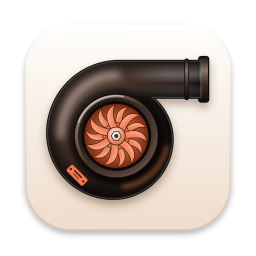

# Turbo

### All-in-one toolkit for macOS

**Launcher, clipboard manager, snippet expander, window manager, mouse fixer, media key fixer, brightness key fixer, in one small native app.**

[](https://github.com/jamieweavis/turbo/actions/workflows/build.yml)
[](https://github.com/jamieweavis/turbo/releases/latest)
[](https://github.com/jamieweavis/turbo/releases)
[](LICENSE)
[](https://github.com/jamieweavis/turbo/releases)

[**Download for Mac**](https://github.com/jamieweavis/turbo/releases/latest) · [Features](#launcher-features) · [Utilities](#utilities) · [Development](#development) · [Changelog](CHANGELOG.md)

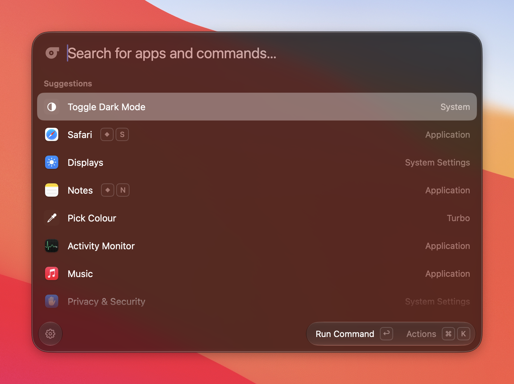

</div>

---

## Contents

- [Why Turbo](#why-turbo)
- [Install](#install)
- [Config file](#config-file)
- [Launcher Features](#launcher-features)
- [Utilities](#utilities)
- [Development](#development)
- [Releasing](#releasing)

## Why Turbo

Many Mac users end up running a handful of menu bar apps to fill the gaps in macOS:

| Type | Example App | Function |
| --- | --- | --- |
| **Launcher** | Raycast  | Quickly launch apps and run commands from a single palette |
| **Window Management** | Rectangle | Manage and arrange windows on your screen |
| **Colour Picker** | Sip | Pick and manage colors from your screen |
| **Keep Awake** | Amphetamine | Prevent your Mac from sleeping |
| **Mouse Fixer** | Mac Mouse Fix | Improve mouse behavior and scrolling with regular mouses |
| **Brightness Key Fixer** | MonitorControl | Allow brightness keys to control external monitors |
| **Media Key Fixer** | BeardedSpice | Control which app responds to media key presses |
| **Window Transform** | Easy Move+Resize | Transform and manipulate windows on your screen with your mouse |


Each app has its own updater, its own settings and its own slice of memory; Turbo replaces them with one app, one settings file and one process:

* **All-in-one**: All tools share one palette, one settings window and one permission grant
* **Fast**: Written in Rust and compiled to native code, the palette opens and updates instantly
* **Small**: A ~5 MB download and a ~10 MB app
* **Light**: Idles at close to zero CPU, uses ~100 MB of memory, and features you switch off stop running entirely
* **Local**: Nothing leaves your Mac; your clipboard, snippets and settings are stored locally
* **Yours**: Free and open source, fork it and make it your own

## Install

> [!IMPORTANT]
> Requires macOS 26 or later

> [!WARNING]
> macOS blocks Turbo the first time you open it, because the app isn't notarised by Apple.
> Steps 2 and 3 below get you past it, and are only needed once

1. Download the `.dmg` from the [latest release](https://github.com/jamieweavis/turbo/releases/latest)
   and drag Turbo to Applications.
2. Open Turbo, and dismiss the macOS warning with **Done** (not Move to Bin).
3. Go to **System Settings → Privacy & Security**, scroll down to the **Security** section and click
   **Open Anyway** next to the message about Turbo, then confirm with your password or Touch ID.
4. Grant Accessibility access when asked. Media Keys also asks, once per music app, to control it.

## Config file

Every setting, from hotkeys and snippets to quicklinks and mouse buttons, lives in one plain TOML file at
`~/.config/turbo/config.toml`.

```toml
[launcher.hotkey]
key_code = 49            # Space
modifiers = ["Option"]

[clipboard]
max_items = 500
retention_days = 30

[[mouse.buttons]]
button = 3
trigger = "Click"
action = "Back"
```

> [!TIP]
> Add to your dotfiles to sync your Turbo configuration across machines

## Launcher Features

- [Launcher](#launcher)
- [Quicklinks](#quicklinks)
- [Shell Commands](#shell-commands)
- [File Search](#file-search)
- [Snippets](#snippets)
- [Clipboard](#clipboard)
- [Window Management](#window-management)
- [Keep Awake](#keep-awake)
- [Colour Picker](#colour-picker)
- [Emoji Picker](#emoji-picker)

### Launcher

Fuzzy-search your apps, ranked by how often you use them, with per-app hotkeys and aliases. Type maths straight into the palette, with unit and currency conversion, or run system actions like Lock Screen, Sleep and Empty Trash, open any System Settings pane and check your webcam with Camera Preview.

<p align="center">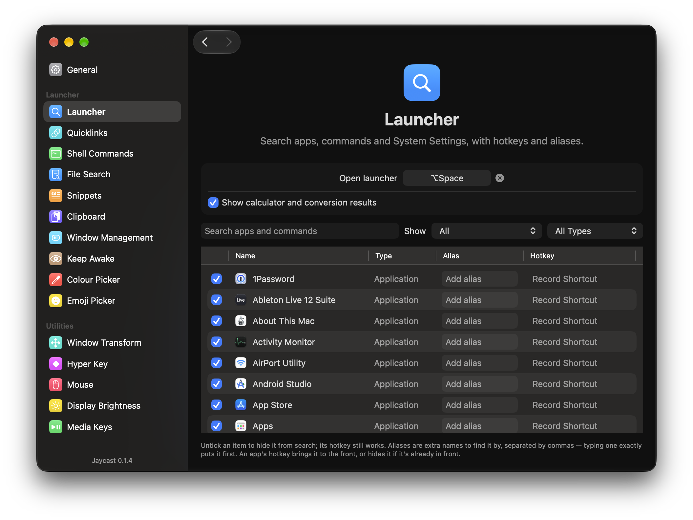</p>

### Quicklinks

Open websites and searches by keyword: `g yorkshire pudding recipe` searches Google for "yorkshire pudding recipe". Each quicklink is a URL template with a `{query}` placeholder for what you type after the keyword, or `{clipboard}` for whatever you last copied, so any site with a search box can be one.

<p align="center">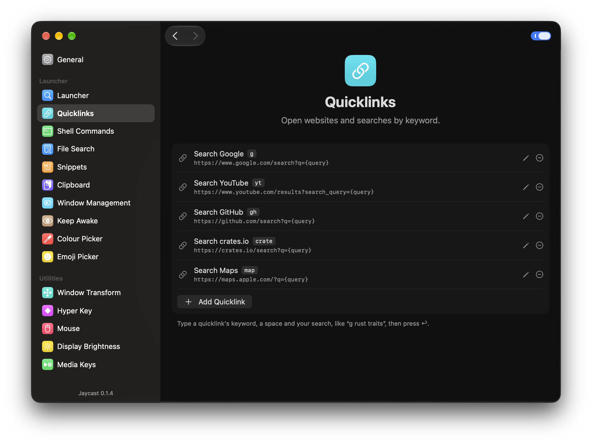</p>

### Shell Commands

Save the shell commands you run often and trigger them from the palette by name or keyword, passing in what you type as `{query}` or the clipboard as `{clipboard}`. Each one can run silently, show its output in a window or copy it to the clipboard, and risky ones can ask for confirmation first.

<p align="center">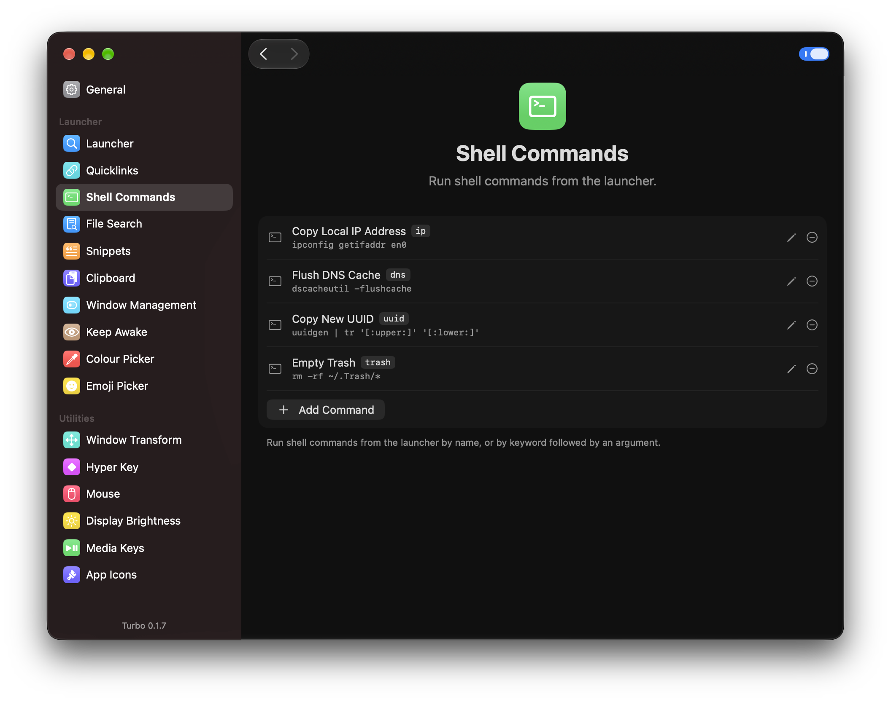</p>

### File Search

Find files with Spotlight, scoped to the folders you choose so results aren't buried under system and library files. Matches are ranked by how well the name fits and how recently the file changed, and you can open one, reveal it in Finder or preview it with Quick Look. Open it from the palette or its own hotkey.

<p align="center">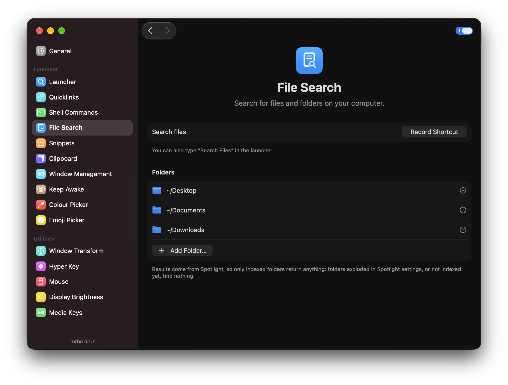</p>

### Snippets

Save text you type again and again, like an email address or a canned reply, and expand it by typing its keyword in any app, or pick it from the palette. Placeholders fill in the clipboard, date or time as it's inserted, and `{cursor}` sets where the caret ends up.

<p align="center">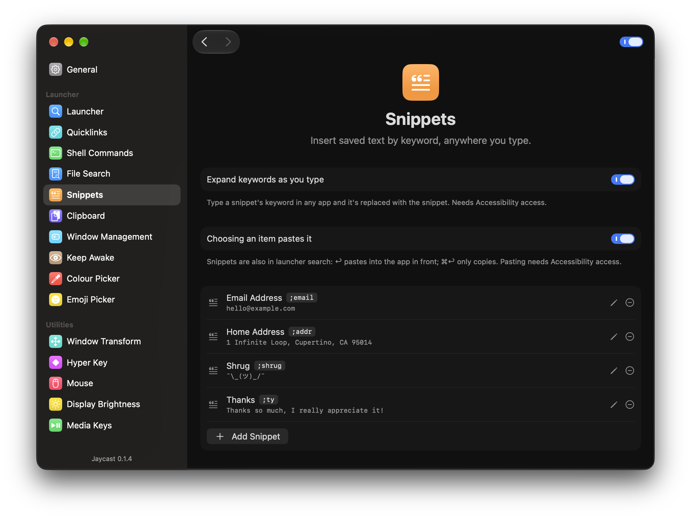</p>

### Clipboard

Search and paste everything you've copied: text, links, colours and images, opened with <kbd>⌥</kbd><kbd>⌘</kbd><kbd>V</kbd>. Pin the items you want to keep, and set how many items and how many days of history to hold on to. Copies from password managers are never recorded.

<p align="center">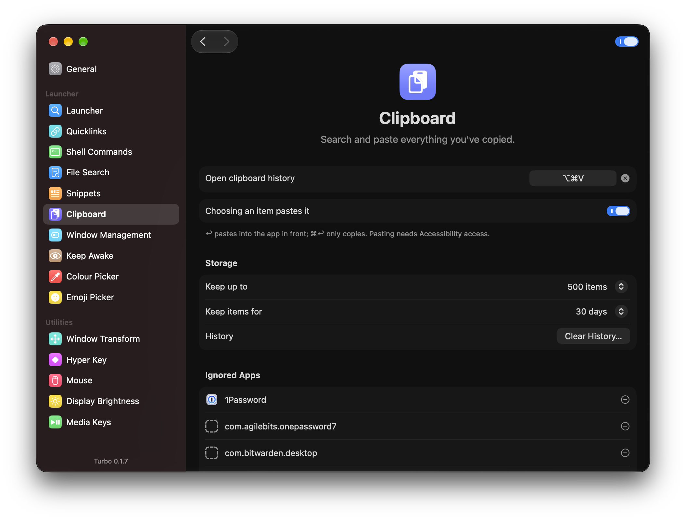</p>

### Window Management

Snap the focused window to halves, quarters, thirds or sixths, maximise or centre it, restore it to where it was and move it between displays, all with hotkeys or from the palette. Pressing a half again cycles its width through a half, two thirds and one third, and an adjustable gap keeps windows from touching.

<p align="center">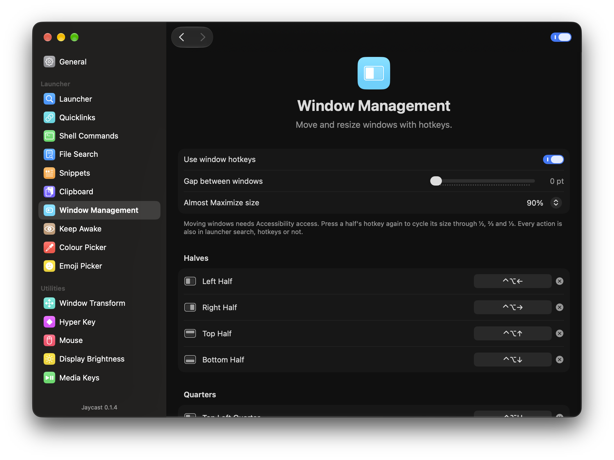</p>

### Keep Awake

Stop your Mac sleeping while a download, build or presentation runs, and optionally keep the display on too. Switch it on and off from the palette or with hotkeys. It stays on across relaunches and updates until you turn it off.

<p align="center">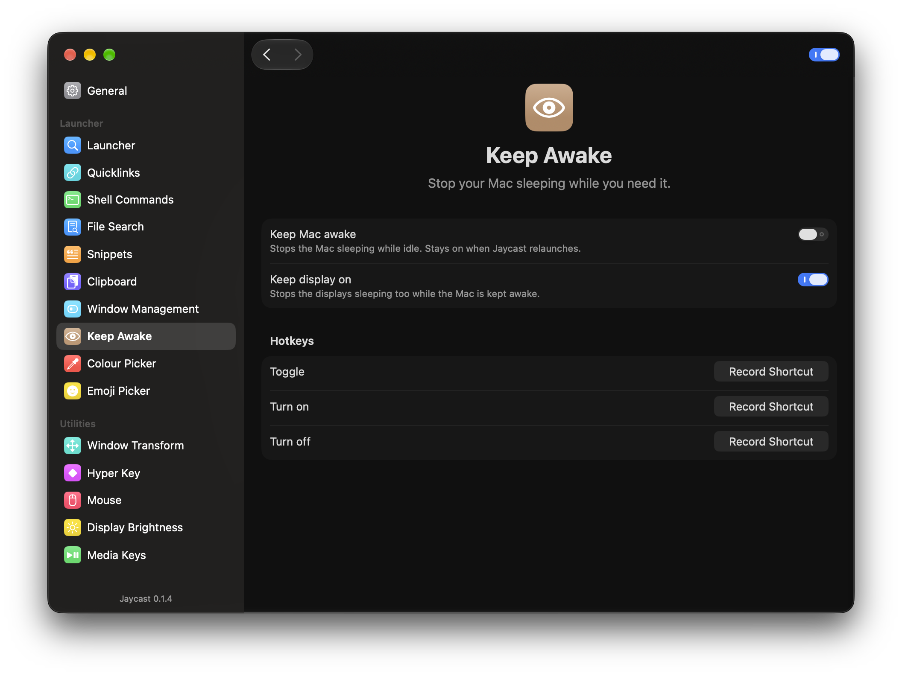</p>

### Colour Picker

Pick a colour from anywhere on screen with the system magnifier, from the palette or a hotkey. It's copied to the clipboard as hex, RGB or HSL, whichever you prefer, and kept in a history you can copy from again.

<p align="center">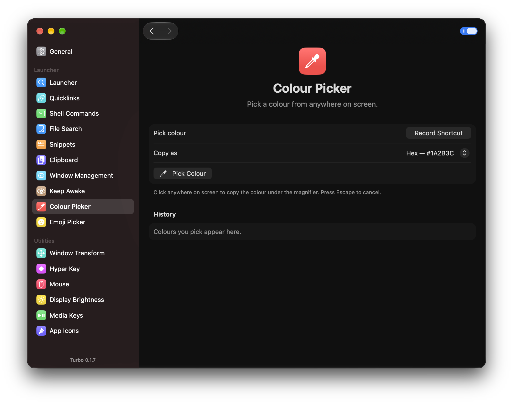</p>

### Emoji Picker

Search every emoji by name or shortcode (`tada`) in a grid, with the ones you used recently kept to hand. Choosing one pastes it straight into the app you were typing in, or just copies it if you'd rather.

<p align="center">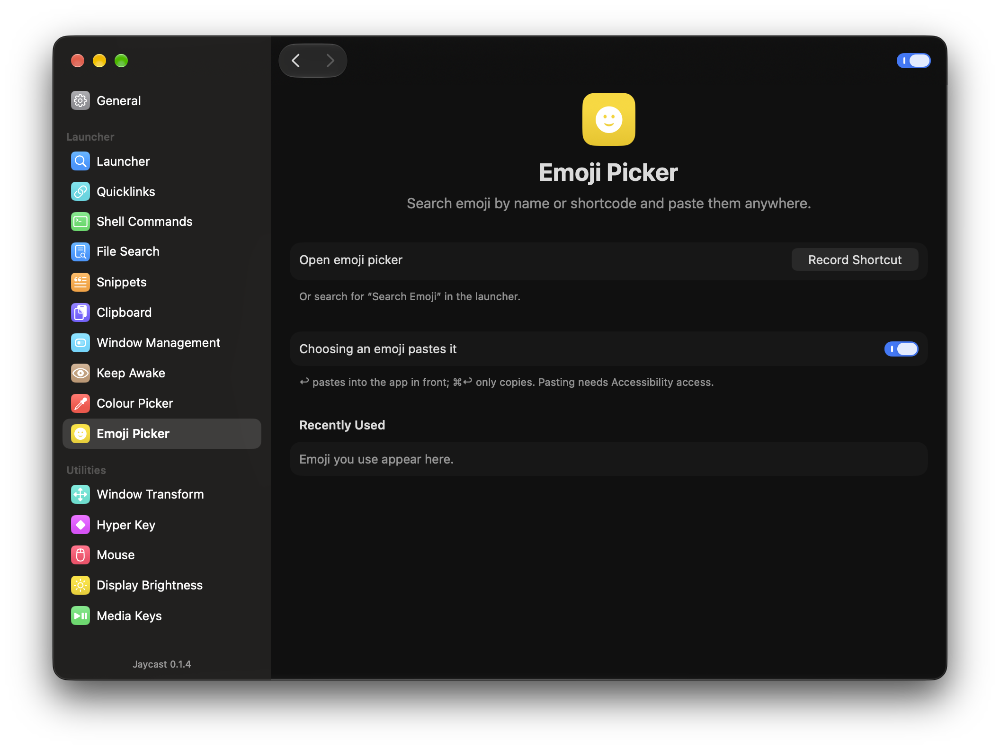</p>

## Utilities

Background fixes for the keyboard, mouse, windows and displays, each with its own switch.

- [Window Transform](#window-transform)
- [Hyper Key](#hyper-key)
- [Mouse](#mouse)
- [Display Brightness](#display-brightness)
- [Media Keys](#media-keys)

### Window Transform

Move and resize a window by dragging anywhere in it with <kbd>⌃</kbd><kbd>⌘</kbd> held, so there's no aiming for the title bar or a thin edge. The left button moves the window under the cursor and the right button resizes it; the modifiers are yours to choose and the buttons can be swapped.

<p align="center">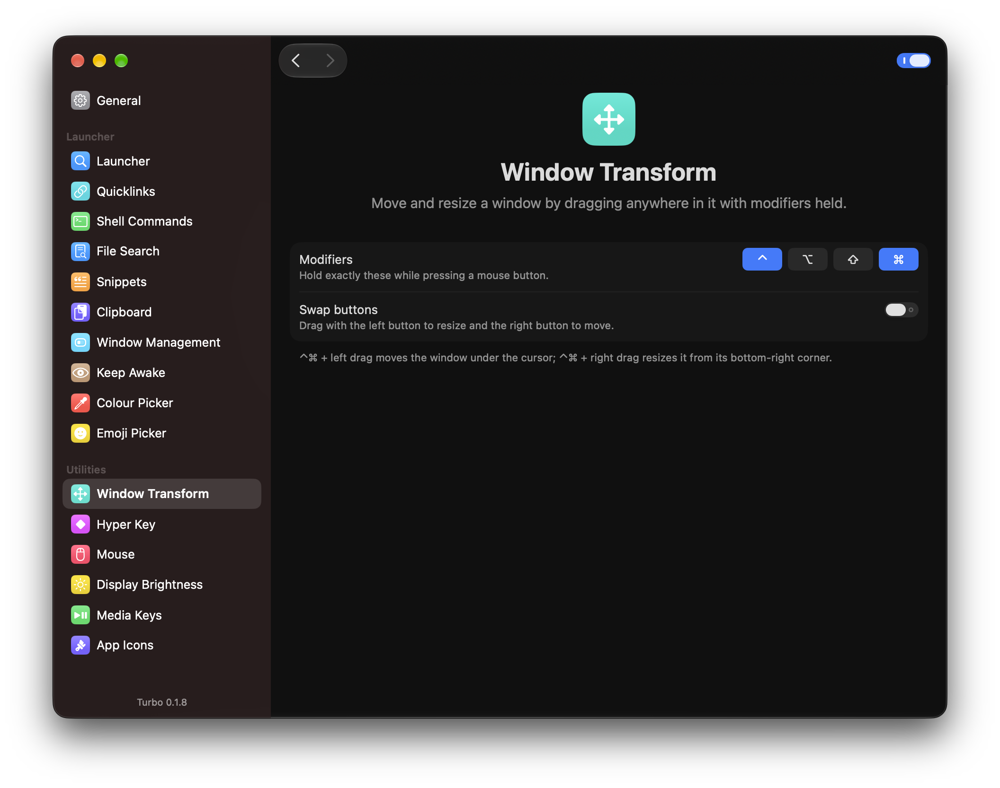</p>

### Hyper Key

Turn Caps Lock, or any left or right modifier, into <kbd>⌃</kbd><kbd>⌥</kbd><kbd>⇧</kbd><kbd>⌘</kbd> while it's held: a combination no app uses, so your own shortcuts never clash. Tapped on its own, the key can send Escape or still toggle Caps Lock.

<p align="center">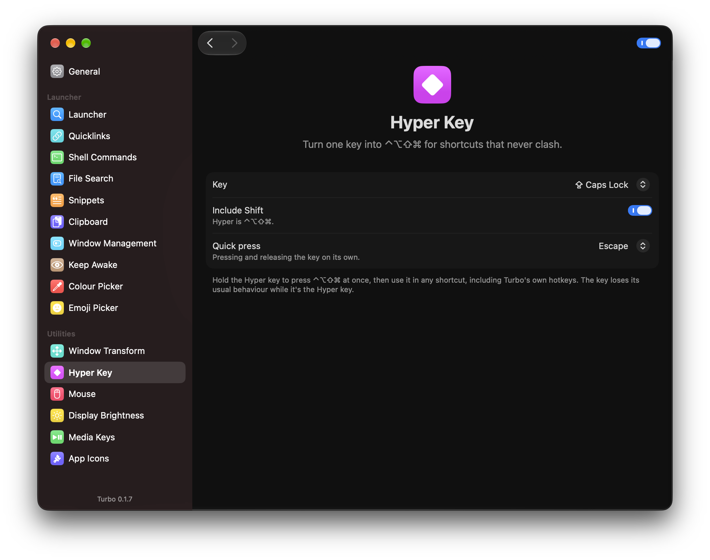</p>

### Mouse

Make an ordinary mouse feel at home on a Mac. Smooth scrolling evens out a clicky wheel, with adjustable speed and trackpad-style bounce and swipe gestures. The wheel's direction can be reversed without affecting the trackpad, and a held modifier scrolls sideways, zooms or scrolls precisely. Extra buttons can be mapped to Back, Forward, Mission Control, switching Spaces or any keyboard shortcut, on click, double click or hold.

<p align="center">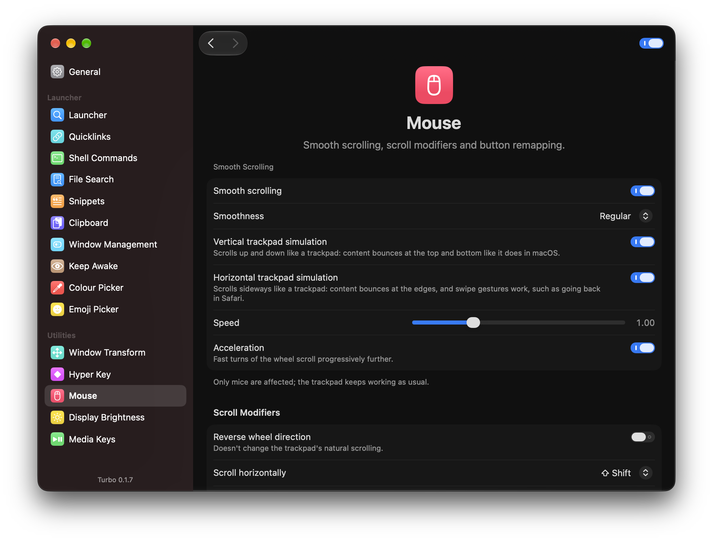</p>

### Display Brightness

Make the keyboard's brightness keys work on external monitors, by talking to them over DDC/CI. The keys adjust whichever display the cursor is on, and the built-in display behaves as it always has. Below the monitor's own minimum, Turbo keeps dimming in software all the way down to black.

<p align="center">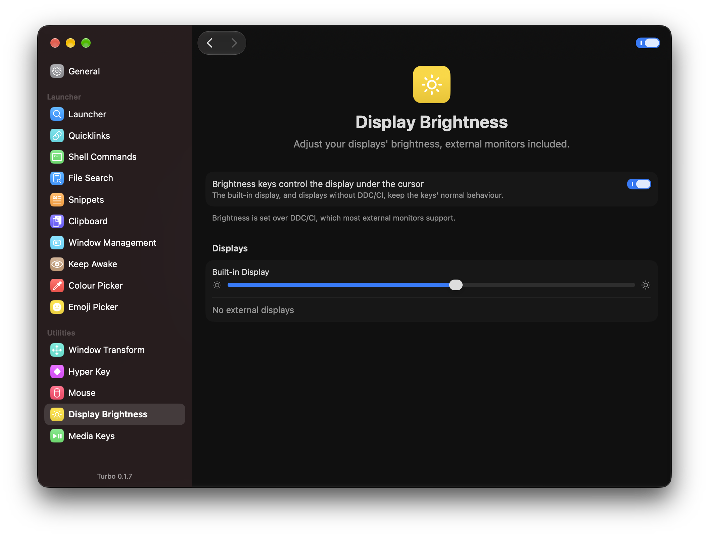</p>

### Media Keys

Send play/pause, next and previous to Spotify, Music or VLC (whichever you used last, or always the one you pick), so they never launch Apple Music. Also in the palette as Play/Pause, Next Track and Previous Track.

<p align="center">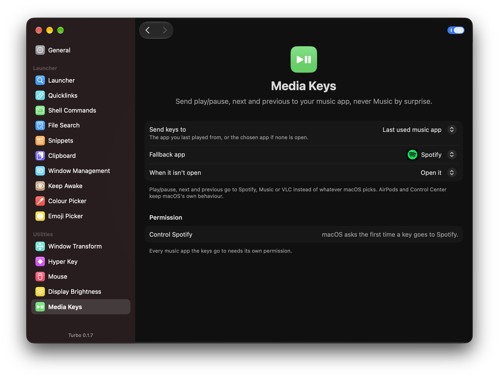</p>

## Development

### Requirements

- macOS 26+
- Rust (stable)
- Xcode, for its toolchain and SDK (the IDE is never opened)
- [`just`](https://just.systems)

### Commands

```sh
just run        # build the core + shell, bundle build/Turbo.app, launch it
just test       # Rust tests
just check      # everything CI runs: fmt, clippy, tests, app build
just logs       # stream the app's logs
just screenshots  # regenerate the README's settings screenshots
just            # list all recipes
```

`CONFIG=release just app` builds optimised. The app is signed with your "Apple Development" identity by
default, so macOS keeps the Accessibility grant across rebuilds. Set `TURBO_SIGN_IDENTITY="-"` to sign
ad hoc.

`just screenshots` relaunches the app with the demo config in `.github/screenshots/demo-config.toml`,
hides your other apps, captures the launcher over the desktop and every settings pane in dark mode to
`.github/screenshots/`, then unhides the apps and relaunches your usual copy.
It needs Screen Recording access the first time, and compresses the images if `oxipng` is installed.

### Project layout

| Path | What's there |
| --- | --- |
| `src/` | The Rust core: all logic and system integration, built as `libturbo_core.a`. |
| `shell/` | Swift/SwiftUI: menu bar, palette, settings and onboarding. Calls the core through [UniFFI](https://mozilla.github.io/uniffi-rs/) bindings generated at build time. |
| `tools/uniffi-bindgen/` | The bindings generator, pinned to the core's UniFFI version. |

## Releasing

Commits follow [Conventional Commits](https://www.conventionalcommits.org) (`feat:`, `fix:`, …). On every
push to `main`, [release-plz](https://release-plz.dev) opens or updates a release PR that bumps the version
and writes `CHANGELOG.md`. Merging it tags `vX.Y.Z`, and CI attaches the `.dmg` (`just dmg`) to the GitHub
Release.
